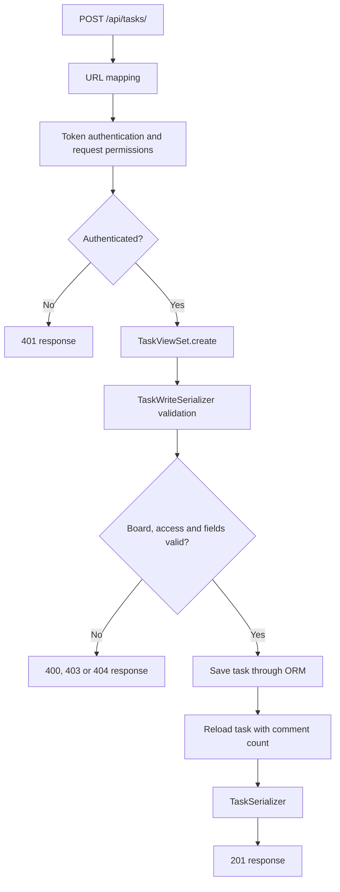

# Application Architecture

[Project README](../README.md) ·
[Data Model](DATA_MODEL.md) ·
[Authentication and Permissions](AUTH_AND_PERMISSIONS.md) ·
[Design Decisions](DESIGN_DECISIONS.md) ·
[Testing](TESTING.md)

---

## Contents

- [Application Architecture](#application-architecture)
  - [Contents](#contents)
  - [Overview](#overview)
  - [Application Boundaries](#application-boundaries)
    - [Why comments belong to tasks\_app](#why-comments-belong-to-tasks_app)
    - [Shared representations](#shared-representations)
  - [Responsibilities](#responsibilities)
  - [Request Processing](#request-processing)
  - [Example: Creating a Task](#example-creating-a-task)
    - [1. Resolve the route](#1-resolve-the-route)
    - [2. Identify the user](#2-identify-the-user)
    - [3. Validate the submitted data](#3-validate-the-submitted-data)
    - [4. Check membership during creation](#4-check-membership-during-creation)
    - [5. Save trusted ownership information](#5-save-trusted-ownership-information)
    - [6. Build the response](#6-build-the-response)
  - [Routing and View Classes](#routing-and-view-classes)
    - [Explicit route mappings](#explicit-route-mappings)
    - [View classes in use](#view-classes-in-use)
  - [Input and Output Serializers](#input-and-output-serializers)
  - [Querysets and Related Data](#querysets-and-related-data)
    - [Access filtering](#access-filtering)
    - [Loading related objects](#loading-related-objects)
    - [Calculated counts](#calculated-counts)
  - [Transactions](#transactions)
  - [Errors and Access Checks](#errors-and-access-checks)
    - [Scoped comment lookup](#scoped-comment-lookup)
    - [URL ID validation](#url-id-validation)
  - [Administration](#administration)
  - [Where to Make Changes](#where-to-make-changes)

---

## Overview

KanMind is a Django application exposing a REST API through Django REST
Framework.

The provided frontend and the backend run as separate applications.
The frontend sends HTTP requests; the backend validates them, applies access
rules and reads or writes data through Django's ORM.

SQLite stores the application data locally. Django migrations define and
version the database schema.

The backend does not render the KanMind frontend. Django Admin is a separate
server-rendered interface for administration.

## Application Boundaries

| Component | Responsibility |
| --- | --- |
| `core` | Project configuration and central routing |
| `auth_app` | User accounts, registration, login and email lookup |
| `boards_app` | Boards, membership and board statistics |
| `tasks_app` | Tasks, assignments, personal task lists and comments |

### Why comments belong to tasks_app

A comment belongs to a task and is accessed through a nested task URL.

Comments therefore remain in `tasks_app`. Their API code is separated into
`comment_serializers.py` and `comment_views.py` to keep task and comment
request handling easy to navigate.

A separate Django app is not required for every model.

### Shared representations

`auth_app.api.serializers.UserSerializer` provides the user representation
used by board members, task assignees and task reviewers.

Board details reuse `BoardTaskSerializer` from `tasks_app` to display nested
tasks. This keeps the task representation consistent wherever that serializer
is used.

These are explicit dependencies between apps. Each app has its own
responsibilities, but they are not isolated services.

## Responsibilities

| Layer | Role in this project |
| --- | --- |
| Settings | Configure installed apps, middleware, database and authentication |
| URLs | Map paths and HTTP methods to views or viewset actions |
| Authentication | Identify the user from the supplied token |
| Permissions | Check whether the user may perform an operation |
| Views | Coordinate lookup, validation, persistence and responses |
| Serializers | Validate input and define response representations |
| Models | Define fields, relationships and readable object labels |
| ORM and querysets | Retrieve, filter, aggregate and persist data |
| User manager | Create users and superusers using the custom user model |

Request-specific access rules are not implemented in model `save()` methods.

The user manager handles account creation details such as password hashing.
API serializers handle input validation before creating or updating objects.

## Request Processing

The following diagram shows the successful task-creation path and its
main rejection points.



URL matching happens before the view processes the request. If no route
matches, Django returns a routing error without entering that API view.

After a route matches, DRF performs authentication and request-level
permission checks before calling the action.

Object-level permission checks happen when an existing object is retrieved.
Creation needs a different approach because the new object does not exist yet.

## Example: Creating a Task

Consider an authenticated request to:

```http
POST /api/tasks/
Authorization: Token <token>
Content-Type: application/json
```

### 1. Resolve the route

`core/urls.py` includes the task app's routes.

`tasks_app/api/urls.py` maps `POST /api/tasks/` to the `create` action of
`TaskViewSet`.

### 2. Identify the user

DRF token authentication resolves the token to a user.

`IsAuthenticated` rejects requests without valid authentication before the
creation action runs.

### 3. Validate the submitted data

`TaskViewSet.create()` constructs `TaskWriteSerializer` with the request data.

Calling `is_valid(raise_exception=True)` checks the supplied fields and runs
the custom validation methods.

The serializer checks:

- Required fields and field formats
- Allowed status and priority values
- Whether the board exists
- Whether the requesting user belongs to the board
- Whether selected assignees and reviewers belong to the board

### 4. Check membership during creation

`IsTaskBoardMember` implements an object-level permission.

A task does not exist before creation, so that permission cannot inspect
a new task through an ordinary object lookup.

For creation, `TaskWriteSerializer.validate_board()` checks membership using
the board supplied in the request.

For updates, the existing task is retrieved and object-level permissions
check access before the serializer processes the changes.

### 5. Save trusted ownership information

`perform_create()` passes the authenticated user as `created_by`:

```python
serializer.save(created_by=self.request.user)
```

The client cannot select another task creator through the write serializer.

The ORM inserts the task into the database.

### 6. Build the response

The view reloads the saved task using its queryset. This supplies the
annotated `comments_count`.

`TaskSerializer` converts the task into the required response representation,
including nested assignee and reviewer data.

The view returns HTTP `201 Created`.

## Routing and View Classes

### Explicit route mappings

The project uses Django `path()` declarations and explicit viewset action
mappings.

Using a `ModelViewSet` does not automatically expose every possible operation.
Only actions mapped in the URL configuration are reachable.

For example:

- `POST /api/tasks/` creates tasks.
- `PATCH /api/tasks/{id}/` updates a task.
- `DELETE /api/tasks/{id}/` deletes a task.
- A general `GET /api/tasks/` list is not exposed.
- A single-task `GET /api/tasks/{id}/` endpoint is not exposed.

The named personal-list routes appear before the general string-based task
detail route, so their names are not interpreted as task IDs.

### View classes in use

| View | Base class | Purpose |
| --- | --- | --- |
| `RegistrationView` | `GenericAPIView` | Registration and token response |
| `LoginView` | `GenericAPIView` | Credential validation and token response |
| `EmailCheckView` | `GenericAPIView` | Validated email lookup |
| `BoardViewSet` | `ModelViewSet` | Board operations with action-specific behavior |
| `TaskViewSet` | `ModelViewSet` | Task operations and personal lists |
| `CommentListCreateView` | `ListCreateAPIView` | List and create comments |
| `CommentDeleteView` | `DestroyAPIView` | Delete a comment |

The implementation reuses DRF behavior where it matches the API contract.
Custom methods handle response differences, additional validation and
action-specific access rules.

## Input and Output Serializers

The API accepts different structures from those it returns.

For example, a task request supplies an `assignee_id`, while its response
contains an `assignee` object with the user's ID, email and full name.

Separate serializers make these differences explicit.

| Serializer | Responsibility |
| --- | --- |
| `BoardWriteSerializer` | Board title and member input |
| `BoardSummarySerializer` | Board metadata and counts |
| `BoardDetailSerializer` | Board details with members and tasks |
| `BoardUpdateResponseSerializer` | Updated board with owner and member data |
| `TaskWriteSerializer` | Task input and relationship validation |
| `BoardTaskSerializer` | Tasks nested inside board details |
| `TaskSerializer` | Task creation and personal-list responses |
| `TaskUpdateResponseSerializer` | Task update responses |
| `CommentSerializer` | Comment input and output |
| `UserSerializer` | Shared public user representation |

The task response serializers intentionally differ:

| Context | Includes `board` | Includes `comments_count` |
| --- | --- | --- |
| Task creation | Yes | Yes |
| Personal task lists | Yes | Yes |
| Task inside board details | No | Yes |
| Task update | No | No |

These differences preserve the required API response shapes.

For partial updates, omitted values remain unchanged. An explicit `null`
clears a nullable assignment. The task serializer also validates retained
assignments against current board membership.

## Querysets and Related Data

A queryset describes which records to retrieve and how to load related data.

Views declare base querysets on the class. Dynamic filtering belongs in
`get_queryset()`.

### Access filtering

Board listing filters by:

- Ownership by the current user, or
- Membership of the current user

`distinct()` prevents duplicate boards when the user matches more than one
relationship.

Personal task lists filter by the authenticated user's assignee or reviewer
relationship.

Object permissions are not automatically applied to every item in a list.
List filtering therefore forms part of the access behavior.

### Loading related objects

The implementation uses:

- `select_related()` for foreign-key relationships such as assignee,
  reviewer and comment author
- `prefetch_related()` for collections such as board members and tasks
- `Prefetch` when nested tasks need a specific queryset

These methods reduce repeated queries when serializers access related objects.

### Calculated counts

Board and comment counts are added to querysets using `annotate()` and
`Count()`.

They are calculated from database relationships rather than maintained as
separate counter fields.

Board counts use `distinct=True` to avoid inflated results when joins include
both multiple members and multiple tasks.

Lists use explicit ordering to provide predictable results.

## Transactions

Selected write operations use `transaction.atomic`:

- Registration
- Board creation and partial updates
- Task creation and partial updates
- Comment creation

A transaction groups database writes. If an exception escapes the atomic
block, its database changes are rolled back.

For registration, this keeps user creation and token creation together.
For board operations, it also groups the board write and membership changes.

A transaction does not replace validation, authentication or permissions.
It also does not by itself guarantee that concurrent requests cannot conflict.

## Errors and Access Checks

The API uses DRF validation and permission exceptions and Django's
`get_object_or_404()` helper.

| Situation | Typical result |
| --- | --- |
| Invalid input | `400 Bad Request` |
| Missing or invalid token | `401 Unauthorized` |
| Authenticated user lacks access | `403 Forbidden` |
| Requested object does not exist | `404 Not Found` |

### Scoped comment lookup

Before deleting a comment, the queryset is restricted to the task ID from
the URL.

The comment is then looked up inside that queryset. A real comment requested
through another task's URL therefore returns HTTP 404.

This checks the parent-child relationship before author permission is applied.

### URL ID validation

Task detail routes and comment deletion routes accept string parameters
so their views can explicitly reject malformed IDs with HTTP 400.

Other routes use integer converters. A malformed value on those routes may
fail during URL matching and return HTTP 404.

Authentication precedes the custom ID validation when the request reaches
a protected API view.

The implementation does not replace every failure with the same generic
response. Validation, denied access and missing resources retain their
distinct meanings.

## Administration

Django Admin is configured for users, boards, tasks and comments.

The custom user model has dedicated admin forms and administration settings
for email-based accounts.

Admin is useful for inspection and deliberate maintenance. It is a separate
interface: API serializers and API permission classes do not automatically
run for edits made through Admin.

An administrative change can therefore create a state that a later API
request rejects, such as an assignment to a user who no longer belongs to
the board.

## Where to Make Changes

| Intended change | Starting point |
| --- | --- |
| Add or change an API route | The owning app's `api/urls.py` |
| Change an accepted request field | The relevant write serializer |
| Change a response field | The relevant response serializer |
| Change access to an existing object | The relevant permission class |
| Change creation access | The view or serializer that resolves the parent resource |
| Change a user-specific list | The view's `get_queryset()` |
| Change database fields or relationships | The model and a new migration |
| Change local configuration or CORS | `core/settings.py` |
| Change user creation behavior | `auth_app/managers.py` |
| Change an admin form or display | The app's admin configuration and forms |

After changing behavior, update the relevant Postman scenarios and
documentation. After changing models, create and review the required
migration.

---

[Back to contents](#contents) · [Project README](../README.md)