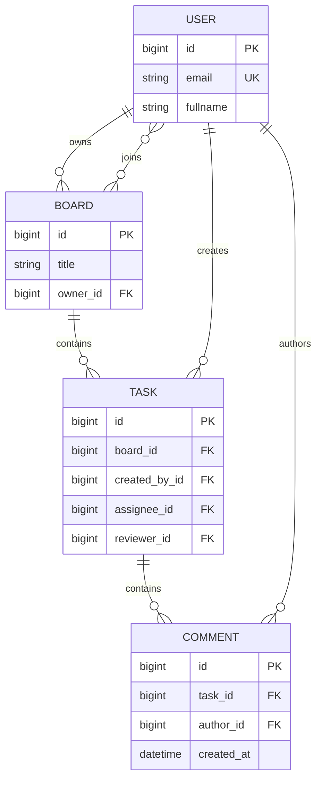

# Data Model

[Project README](../README.md) ·
[Architecture](ARCHITECTURE.md) ·
[Authentication and Permissions](AUTH_AND_PERMISSIONS.md) ·
[Design Decisions](DESIGN_DECISIONS.md) ·
[Testing](TESTING.md)

---

## Contents

- [Data Model](#data-model)
  - [Contents](#contents)
  - [Overview](#overview)
  - [Entity Relationships](#entity-relationships)
  - [User](#user)
    - [Email handling](#email-handling)
    - [Display label](#display-label)
  - [Board](#board)
  - [Task](#task)
    - [Status and priority](#status-and-priority)
    - [Optional assignments](#optional-assignments)
    - [Creator and assignee are different roles](#creator-and-assignee-are-different-roles)
  - [Comment](#comment)
  - [Reverse Relationships](#reverse-relationships)
  - [Deletion Behavior](#deletion-behavior)
    - [Deleting a board](#deleting-a-board)
    - [Deleting a task](#deleting-a-task)
    - [Deleting a comment](#deleting-a-comment)
    - [Deleting a user](#deleting-a-user)
  - [Membership and Assignments](#membership-and-assignments)
  - [Calculated Fields](#calculated-fields)
  - [Database Rules and API Validation](#database-rules-and-api-validation)
  - [Migrations and Local Data](#migrations-and-local-data)

---

## Overview

KanMind defines four application models:

| Model | Location | Purpose |
| --- | --- | --- |
| `User` | `auth_app/models.py` | Email-based accounts |
| `Board` | `boards_app/models.py` | Boards with owners and members |
| `Task` | `tasks_app/models.py` | Work items belonging to boards |
| `Comment` | `tasks_app/models.py` | Authored messages belonging to tasks |

Django adds an automatic primary key named `id` to each model.

The project uses SQLite for local persistence. Django migrations create
the tables, foreign keys and the intermediate table for board membership.

Django also maintains framework tables for authentication, tokens, sessions
and administration. They are not additional KanMind domain models.

## Entity Relationships

The diagram shows the main ownership and containment relationships.
Optional task assignments are described separately below.



Each board has exactly one owner and can have zero or more members.

Each task belongs to exactly one board and has exactly one creator.
Its assignee and reviewer are independent, optional user relationships.

Each comment belongs to exactly one task and has exactly one author.

The many-to-many membership table is created automatically by Django and
is not shown as a separate entity in this diagram.

## User

`User` extends Django's `AbstractUser`.

The project removes the username field and uses a unique email address
as the login identifier.

| Field or configuration | Definition |
| --- | --- |
| `username` | Removed from the custom model |
| `email` | Unique `EmailField` |
| `fullname` | `CharField`, maximum 255 characters |
| `USERNAME_FIELD` | `email` |
| `REQUIRED_FIELDS` | `fullname` |
| Manager | Custom `UserManager` |

The model retains inherited authentication fields such as:

- `password`
- `is_active`
- `is_staff`
- `is_superuser`
- `last_login`
- `date_joined`
- Groups and user permissions

Passwords are stored as encoded password hashes through Django's password
handling, not as plaintext.

`REQUIRED_FIELDS` supplies additional prompts for `createsuperuser`.
API registration requirements are defined by the registration serializer.

Relationships to users reference `settings.AUTH_USER_MODEL`, which points
to `auth_app.User`.

### Email handling

The user manager normalizes the email domain. Registration also normalizes
the email before checking uniqueness.

This does not mean that the entire email address is stored in lowercase or
that every email lookup is case-insensitive.

### Display label

`User.__str__()` returns the email address for readable administration
and object displays.

## Board

| Field | Type | Meaning |
| --- | --- | --- |
| `title` | `CharField`, maximum 255 characters | Board name |
| `owner` | Required foreign key to `User` | Board owner |
| `members` | Optional many-to-many relationship to `User` | Board membership |

Ownership and membership are separate relationships.

A user can own a board without being one of its members. Creating a board
does not automatically add the owner to the membership table.

This distinction matters because board management and task participation
have different access rules.

`Board.__str__()` returns the title.

## Task

| Field | Type | Default or requirement |
| --- | --- | --- |
| `board` | Foreign key to `Board` | Required |
| `title` | `CharField`, maximum 255 characters | Required |
| `description` | `TextField` | Blank allowed |
| `status` | `CharField`, maximum 20 characters | Defaults to `to-do` |
| `priority` | `CharField`, maximum 10 characters | Defaults to `medium` |
| `assignee` | Foreign key to `User` | Optional; database `NULL` allowed |
| `reviewer` | Foreign key to `User` | Optional; database `NULL` allowed |
| `due_date` | `DateField` | Required |
| `created_by` | Foreign key to `User` | Required; set from the authenticated user during API creation |

### Status and priority

The model defines the available values using `models.TextChoices`.

| Status value | Display label |
| --- | --- |
| `to-do` | To do |
| `in-progress` | In progress |
| `review` | Review |
| `done` | Done |

| Priority value | Display label |
| --- | --- |
| `low` | Low |
| `medium` | Medium |
| `high` | High |

The database stores the values, such as `in-progress`.
The labels provide readable names for interfaces such as Django Admin.

### Optional assignments

A task can have:

- Neither an assignee nor a reviewer
- Only an assignee
- Only a reviewer
- Both an assignee and a reviewer

The same user may hold both assignments; the model does not require them
to be different people.

`null=True` permits a database `NULL`.
`blank=True` allows an empty value during model/form validation.
The API serializer separately allows explicit JSON `null` values.

### Creator and assignee are different roles

`created_by` records who created the task.
`assignee` records who is assigned to work on it.

Changing the assignee does not change the creator.

`Task.__str__()` returns the title.

## Comment

| Field | Type | Meaning |
| --- | --- | --- |
| `task` | Required foreign key to `Task` | Parent task |
| `author` | Required foreign key to `User` | Comment author |
| `content` | `TextField` | Comment text |
| `created_at` | `DateTimeField(auto_now_add=True)` | Creation timestamp |

API creation supplies the author from the authenticated user.
A client cannot select another author through the comment serializer.

Comments have default ordering by `created_at`, followed by `id`.
The ID provides a stable secondary ordering when timestamps are equal.

The API exposes the author's full name, while the database stores the
relationship to the user. The displayed name is therefore not a separate
historical snapshot stored on the comment.

`Comment.__str__()` returns a label containing the comment and task IDs.

## Reverse Relationships

Explicit `related_name` values make relationships readable from the
referenced object's side.

| Relationship | Reverse access | Meaning |
| --- | --- | --- |
| `Board.owner` | `user.owned_boards` | Boards owned by a user |
| `Board.members` | `user.member_boards` | Boards a user belongs to |
| `Task.board` | `board.tasks` | Tasks belonging to a board |
| `Task.assignee` | `user.assigned_tasks` | Tasks assigned to a user |
| `Task.reviewer` | `user.reviewing_tasks` | Tasks reviewed by a user |
| `Task.created_by` | `user.created_tasks` | Tasks created by a user |
| `Comment.task` | `task.comments` | Comments belonging to a task |
| `Comment.author` | `user.task_comments` | Comments written by a user |

These names also support queryset filtering and aggregation.
For example, counting `"comments"` uses the reverse relationship from
a task to its comments.

## Deletion Behavior

Each foreign key defines what Django should do when its referenced object
is deleted.

| Field | `on_delete` | Effect when the referenced object is deleted |
| --- | --- | --- |
| `Board.owner` | `PROTECT` | Prevent deletion of a user who owns a board |
| `Task.board` | `CASCADE` | Delete tasks when their board is deleted |
| `Task.assignee` | `SET_NULL` | Clear the assignment if user deletion succeeds |
| `Task.reviewer` | `SET_NULL` | Clear the reviewer if user deletion succeeds |
| `Task.created_by` | `PROTECT` | Prevent deletion of a user who created a remaining task |
| `Comment.task` | `CASCADE` | Delete comments when their task is deleted |
| `Comment.author` | `PROTECT` | Prevent deletion of a user who authored a remaining comment |

### Deleting a board

Deleting a board removes:

1. The board
2. Its membership links
3. Its tasks
4. Comments belonging to those tasks

It does not delete the owner, members, task creators or comment authors.

### Deleting a task

Deleting a task removes that task and its comments.

The board and related users remain.

### Deleting a comment

Deleting a comment removes only that comment.
Its task and author remain.

### Deleting a user

`SET_NULL` does not guarantee that a user can be deleted.

If the same user owns a board, created a remaining task or authored a
remaining comment, a protected relationship prevents deletion.

If no protected relationship blocks deletion, assignment references can
be cleared and the user's membership links are removed.

There is no user deletion API endpoint. Deliberate user cleanup must account
for these relationships.

These behaviors describe deletion through Django's ORM. `on_delete` should
not be treated as a promise about arbitrary raw SQL executed outside Django.

## Membership and Assignments

Removing a user from `Board.members` removes a membership link.
It does not delete the user.

It also does not automatically clear that user's task assignments,
delete their tasks or delete their comments.

As a result, a task can temporarily retain an assignee or reviewer who
has left its board.

The task write serializer revalidates the effective assignments during
updates, including assignments omitted from a partial request.

For example:

1. A reviewer is removed from the board.
2. The task still references that reviewer.
3. An unrelated task update is rejected while that assignment remains invalid.
4. A permitted user can clear the reviewer with `reviewer_id: null`,
   replace the reviewer with a member, or restore membership.

This behavior comes from API validation. It is not enforced by a database
constraint connecting assignments to the membership table.

## Calculated Fields

The API returns several values that are not stored model fields.

| Response field | Calculation |
| --- | --- |
| `member_count` | Number of board members |
| `ticket_count` | Number of tasks on the board |
| `tasks_to_do_count` | Number of board tasks with status `to-do` |
| `tasks_high_prio_count` | Number of board tasks with priority `high` |
| `comments_count` | Number of comments on a task |

Querysets supply these values using annotations.

This avoids maintaining separate counters whenever tasks, memberships or
comments change.

The high-priority count filters by priority. It does not additionally
exclude completed tasks.

## Database Rules and API Validation

Database relationships and API validation solve different problems.

| Rule | Implemented through |
| --- | --- |
| Unique email | Unique model field/database constraint, with registration validation |
| Existing referenced user or board | Foreign-key relationships and API lookups |
| Board membership for task creation | Task serializer |
| Permission to update an existing task | Object permission |
| Assignee and reviewer membership | Task serializer |
| Task board cannot change through the API | Task serializer |
| Allowed task status and priority | Model choices used by serializer validation |
| Nonblank comment content | Comment serializer validation |
| Ownership and authorship from the request user | API save logic |

Model choices do not automatically create database check constraints for
every allowed value.

Likewise, API serializer validation does not automatically run when data
is changed through a shell, custom script or Django Admin.

Administrative changes must therefore respect the same domain rules.

## Migrations and Local Data

Migration files are versioned with the source code.
The SQLite database is local and excluded from Git.

For a fresh installation:

```bash
python manage.py migrate
```

After intentionally changing model fields or relationships:

```bash
python manage.py makemigrations
python manage.py migrate
```

Review generated migrations before committing them.

To check whether model changes are missing migrations without writing files:

```bash
python manage.py makemigrations --check --dry-run
```

A fresh installation creates the schema without copying development users,
boards, tasks or comments.

Tests and application workflows should use IDs returned by the API.
Auto-generated IDs are not guaranteed to be consecutive, and deleted
records can leave gaps.

---

[Back to contents](#contents) · [Project README](../README.md)